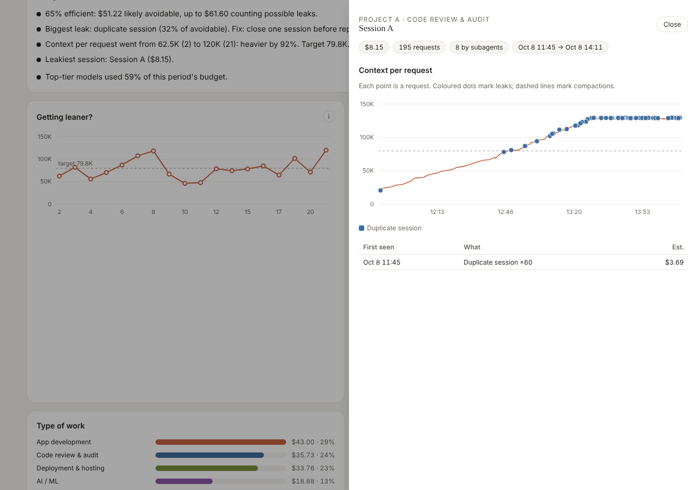
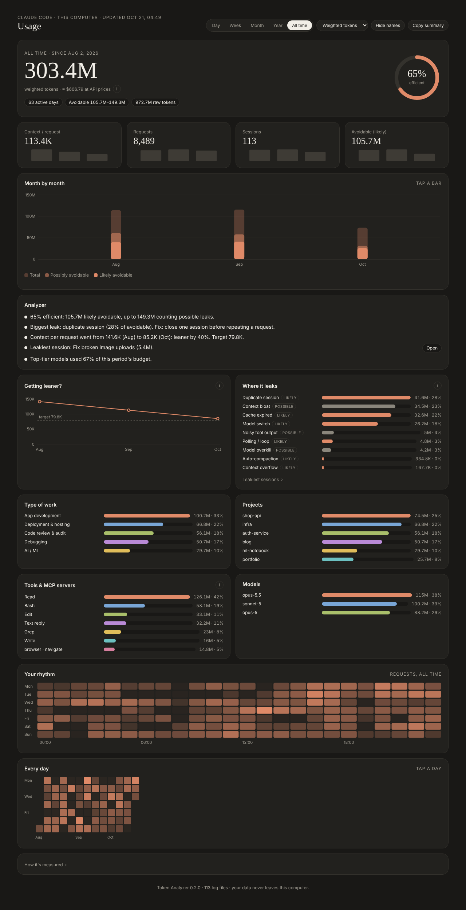

# Token Analyzer for Claude Code

See where your Claude Code tokens go, how close you are to your plan limits, and how to waste fewer of them.

A Claude Code plugin that reads the session logs already on your computer and builds a private dashboard: usage by day, week, month, year and all time, exact 5-hour windows, your real plan-limit percentages, a token-leak analyzer with one-tap fixes, live warnings while you work, and a short daily report. Everything runs locally in plain Python. It makes no network calls and spends no tokens.


| Session drill-down | All time (dark) | Phone |
|---|---|---|
|  |  |  |

*Screenshots use synthetic demo data.*

## Install

In Claude Code:

```
/plugin marketplace add mahadi2002/claude-token-analyzer
/plugin install token-analyzer@mahadi-plugins
```

Requires Python 3.9+ on your PATH (`python3` or `python`). No packages to install.

Then:

1. Run `/token-analyzer:usage` once. It reads your logs, writes the report and opens the dashboard in your browser. After that it refreshes itself in the background the first time you start Claude Code each day.
2. Optional, recommended: run `/token-analyzer:setup-statusline` to show `5h 42% · 7d 18% · ctx 31%` in your status line and record your real plan-limit use for the dashboard. Your previous status line keeps working after ours.

## Updates

Turn on auto-update for `mahadi-plugins` in `/plugin`, or run `/plugin marketplace update mahadi-plugins`, then restart Claude Code. Your settings, labels and history live outside the plugin and are kept.

## What you get

**Five views.** Day, Week, Month, Year and All time, each with one headline number, an efficiency ring, four tiles with small trends, and charts you can hover. Tap a bar to zoom in from a year to a month to a day. Explanations sit behind small `i` buttons.

**Plan limits.** With the status line set up, the dashboard shows your official 5-hour and weekly percentages, when they reset, and when you'd run out at the current pace. It also estimates how many weighted tokens 1% of your 5-hour limit is, so any chart can be read in "% of a 5-hour limit".

**Exact 5-hour windows.** The Day view shades each window (it opens at your first request after the previous one closed) so you can see which ones you filled.

**Token-leak analyzer.** Each request gets at most one cause, so nothing is counted twice. "Avoidable" is shown as a range: likely to possible.

| Leak | Confidence | Rule (configurable) | Usual fix |
|---|---|---|---|
| Duplicate session | likely | same first prompt in two sessions within 24 h | close one before repeating |
| Polling / loop | likely | 100+ requests in an hour, under 50 output tokens each | ask for one final report |
| Cache expired | likely | session resumed after the prompt cache expired (1 h on a subscription, 5 min on an API key) | fresh session with a handoff note |
| Model switch | likely | model changed mid-session | choose the model at the start |
| Auto-compaction / overflow | likely | context filled up and was compacted or reloaded | compact earlier, split big tasks |
| Noisy tool output | possible | a tool result over 20k characters kept in context | quiet flags, subagents |
| Model overkill | possible | Opus or Fable used for light steps | Sonnet or Haiku for routine work |
| Context bloat | possible | context per request above your target (your own median, 60k–150k) | `/compact` at milestones, `/clear` between tasks |

**Live nudges.** Before a prompt, a one-line warning appears if the context is far above your target or the cache has expired on a large session. It shows once per session, uses no tokens, and can be turned off.

**Session drill-down.** Tap any session to see its context per request over time, with leaks and compactions marked.

**Daily report and tips.** Rule-based, so it costs nothing. Tips come with copy buttons: a handoff prompt for retiring a long session, a ready `/compact` instruction, and so on.

**Breakdowns.** Type of work, projects, tools and MCP servers, models, your weekly rhythm and a calendar heatmap.

**Privacy controls.** "Hide names" replaces session titles and project names; "Copy summary" gives a shareable text with no names.

## How the numbers work

- **Cost** uses Anthropic's published API price for each model (`data/pricing.json`, checked against the [pricing page](https://platform.claude.com/docs/en/about-claude/pricing)), with 1-hour cache writes (2× input) and 5-minute writes (1.25×) priced separately and per-model cache-read rates.
- **Weighted tokens** are that cost expressed in Sonnet 5 input tokens, so models compare fairly and cheap cache reads don't dominate. Anthropic does not publish exactly how subscription limits are counted; the status-line calibration checks the approximation against your real limit readings.
- **A day** runs from `day_start_hour` (default 06:00) to the same time next day; weeks start on Monday.
- Requests are de-duplicated by message and request id; subagent requests count toward their parent session.

## Privacy

Your logs never leave your computer. Generated files go to `~/.claude-token-analyzer/out/`. `dashboard.html` is one offline file that contains your session titles unless privacy mode is on; don't share it unless you mean to.

## Customize

Your settings live outside the plugin, so updates never overwrite them:

```
~/.claude-token-analyzer/
  config.json   plan, cache lifetime, day start, context target, thresholds, privacy, nudges, auto-refresh
  labels.json   {"<first 8 chars of a session id>": ["Project", "Task type"]}
  limits.jsonl  plan-limit readings from the status line
  out/          agg.json, CSVs, report.json, report.md, dashboard.html
```

Projects come from each session's working folder; task types from keyword rules on the title and first prompt (`TASK_RULES` in `scripts/analyze.py`). Set `CTA_HOME` to keep the data somewhere else. Ask Claude about your usage any time; the bundled skill knows where everything is.

Run the scripts directly if you prefer:

```
python3 scripts/refresh.py --open
python3 scripts/make_report.py --day 2026-10-20 --force
```

## Limits

- Covers Claude Code (and Claude Desktop local-agent sessions) on this computer. claude.ai chats, the phone app and cloud sessions leave no local logs, though they share your plan limits.
- Reads Claude Code's local log format, which Anthropic does not document and may change. If parsing breaks after an update, please open an issue.
- Hooks need a shell with `python3` or `python`. On Windows, Claude Code runs hooks through Git Bash.

## Development

```
.claude-plugin/   plugin and marketplace manifests (+ icon)
hooks/            daily background refresh (SessionStart), live nudges (UserPromptSubmit)
commands/         /token-analyzer:usage, /token-analyzer:setup-statusline
skills/           answers questions about your usage, explains settings
scripts/          parse_logs, analyze, limits, build_usage, make_report, render_dashboard, refresh, hook, nudge, statusline
data/             pricing.json
dashboard/        page.html, app.js, theme.css, vendored d3
tests/            synthetic log generator, rule tests, end-to-end test
tools/release.py  bump version, stamp changelog, tag, push
```

Run the tests with `python3 -m unittest discover -s tests`. CI runs them on Windows, macOS and Linux.

## License

Apache-2.0. Bundled d3 is ISC-licensed; see [THIRD_PARTY_NOTICES.md](THIRD_PARTY_NOTICES.md).

Built by [Mahadi Hasan Tanmay](https://github.com/mahadi2002).
