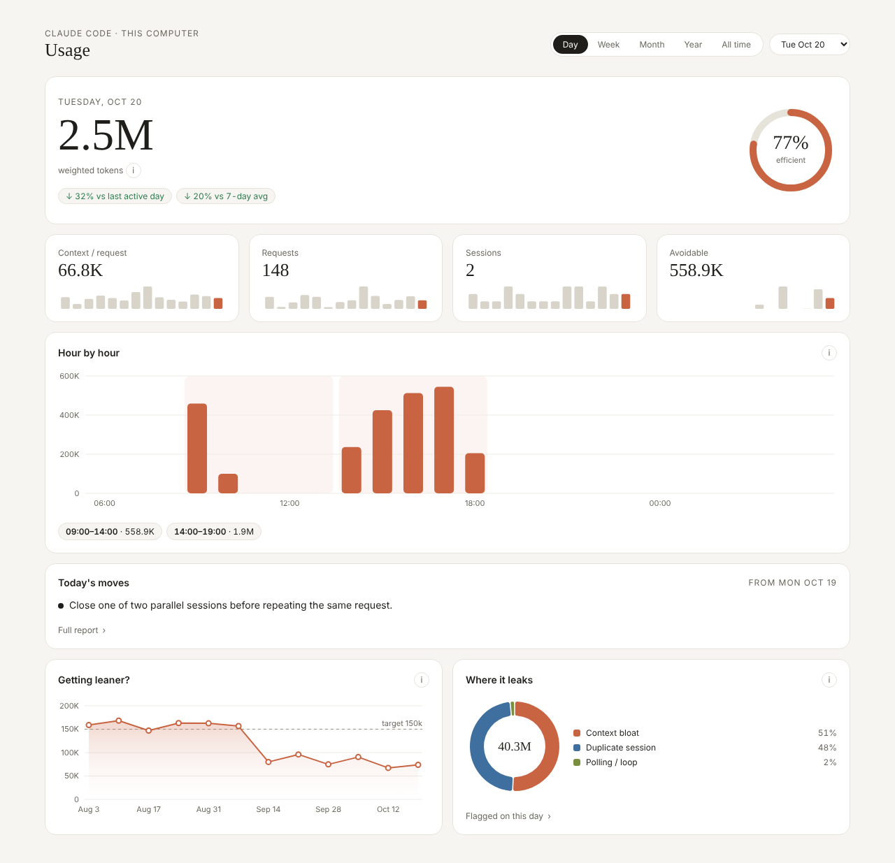
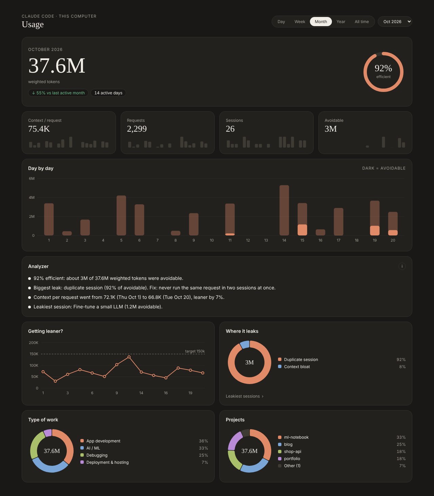
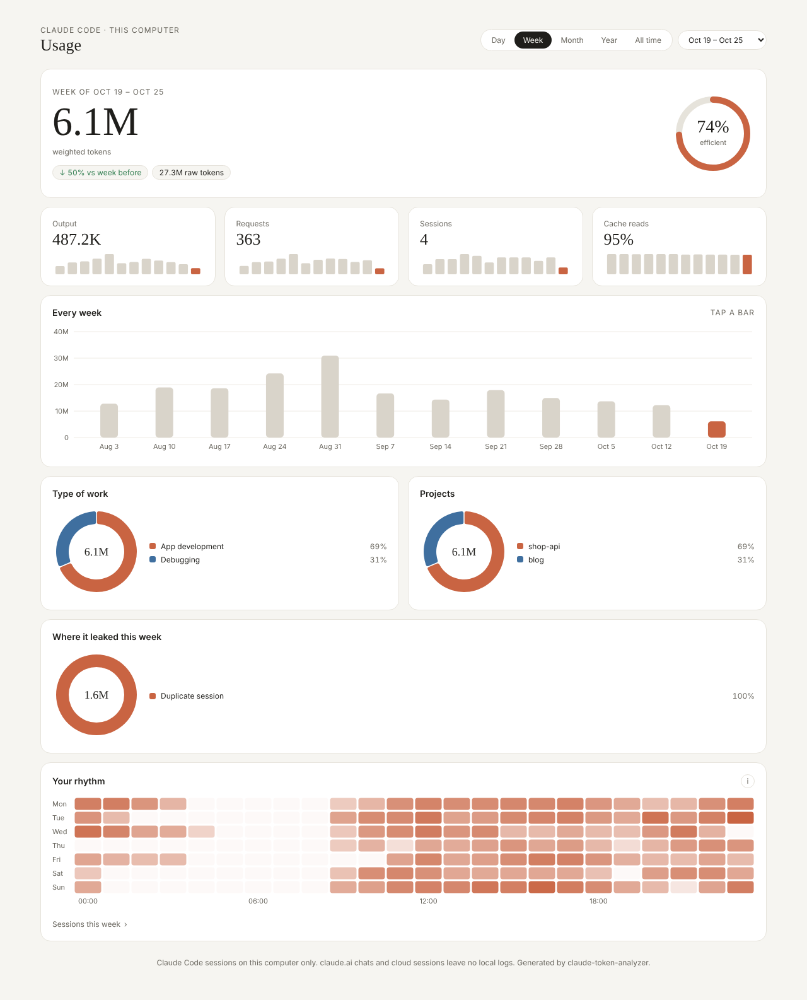
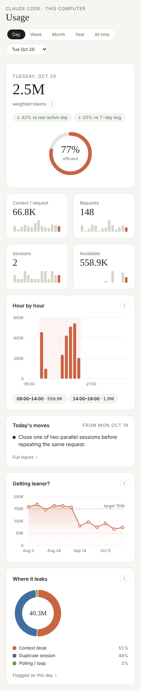

# Claude Token Analyzer

See where your Claude Code tokens go, and how to waste fewer of them.

A Claude Code plugin that reads the session logs already on your computer and builds a private dashboard: usage by day, week, month, year and all time, 5-hour usage windows, a token-leak analyzer, and a short daily report with tips. Everything runs locally with plain Python. It makes no network calls and spends no tokens.



| Month view (dark) | Week view | Phone |
|---|---|---|
|  |  |  |

*Screenshots use synthetic demo data.*

## Install

In Claude Code:

```
/plugin marketplace add mahadi2002/claude-token-analyzer
/plugin install token-analyzer@mahadi-plugins
```

Requires Python 3.9+ on your PATH (`python3` or `python`). No packages to install.

Then run `/token-analyzer:usage` once. It reads your logs, writes the report and opens the dashboard in your browser. After that the dashboard refreshes itself in the background the first time you start Claude Code each day.

## What you get

**Five views.** Day, Week, Month, Year and All time. Each has one headline number, an efficiency ring, four tiles with small trend bars, and charts you can hover. Explanations sit behind small `i` buttons and taps instead of filling the screen.

**Hour by hour with 5-hour windows.** Claude's usage limits reset in 5-hour windows. The Day view shades each window so you can see which ones you filled.

**Token-leak analyzer.** Flags five patterns that burn tokens without producing much:

| Leak | Rule (configurable) | Usual fix |
|---|---|---|
| Context bloat | over 150k context tokens per request | one task per session, `/compact` at milestones |
| Old session resumed | idle over 24 h, then over 50k tokens re-cached | fresh session with a short handoff note |
| Duplicate session | same first prompt in two sessions within 24 h | close one before repeating |
| Polling / loop | 100+ requests in an hour, under 50 output tokens each | ask for one final report |
| Context overflow | chat ran out of context and was reloaded from a summary | split big tasks earlier |

**Daily report.** Each day gets a short summary, what leaked, what to do today and the trend against your last 7 active days. It is generated by fixed rules, so it costs nothing. Ask Claude about it any time; the bundled skill knows where the data is.

## How the numbers work

- **Weighted tokens** count each token type by its relative price: input ×1, cache write ×1.25, cache read ×0.1, output ×5. These are the ratios in Anthropic's published API pricing. Raw totals are mostly cheap cache reads, so weighted tokens track cost and limits better. Anthropic does not publish exactly how subscription limits are counted, so treat this as an approximation.
- **Avoidable** is an estimate of what a leaner workflow would have saved, using the rules above. Read it as a direction, not an invoice.
- **A day** runs from `day_start_hour` (default 06:00) to the same time next day, so late-night work counts toward the day you started it. Weeks start on Monday.
- Requests are de-duplicated by message and request id, because streamed responses log the same usage more than once.

## Privacy

Your logs never leave your computer. Generated files go to `~/.claude-token-analyzer/out/`. `dashboard.html` is a single offline file that contains your session titles; don't share it unless you mean to. The plugin folder never stores your data.

## Customize

Your settings live outside the plugin, so updates never overwrite them:

```
~/.claude-token-analyzer/
  config.json   thresholds, day start, weights, auto-refresh on/off
  labels.json   {"<first 8 chars of a session id>": ["Project", "Task type"]}
  out/          usage_hourly.csv, daily.csv, events.csv, report.json, report.md, dashboard.html
```

Projects come from each session's working folder. Task types come from keyword rules on the session title and first prompt (`TASK_RULES` in `scripts/build_usage.py`); use `labels.json` to correct any session. Set `CTA_HOME` to keep the data somewhere else.

Run the scripts directly if you prefer:

```
python3 scripts/refresh.py --open      # rebuild everything and open the dashboard
python3 scripts/make_report.py --day 2026-10-20 --force
```

## Updates

New versions arrive through the plugin marketplace: run `/plugin marketplace update mahadi-plugins`, or turn on auto-update for this marketplace in `/plugin`. Your config, labels and history are kept. To change the core, fork the repo; it is Apache-2.0.

## Limits

- Covers Claude Code sessions on this computer only. claude.ai chats, the mobile app and cloud sessions leave no local logs.
- Reads Claude Code's local log format, which Anthropic does not document and may change. If an update breaks parsing, please open an issue.
- The session-start hook needs a shell with `python3` or `python`. On Windows, Claude Code runs hooks through Git Bash.

## Layout

```
.claude-plugin/   plugin and marketplace manifests
hooks/            once-a-day background refresh at session start
commands/         /token-analyzer:usage
skills/           answers questions about your usage, explains settings
scripts/          build_usage.py, make_report.py, render_dashboard.py, refresh.py, hook.py
dashboard/        page, theme, small runtime, vendored d3
tests/            synthetic log generator and an end-to-end test
```

Run the tests with `python3 -m unittest discover -s tests`.

## License

Apache-2.0. Bundled d3 is ISC-licensed; see [THIRD_PARTY_NOTICES.md](THIRD_PARTY_NOTICES.md).

Built by [Mahadi Hasan Tanmay](https://github.com/mahadi2002).
